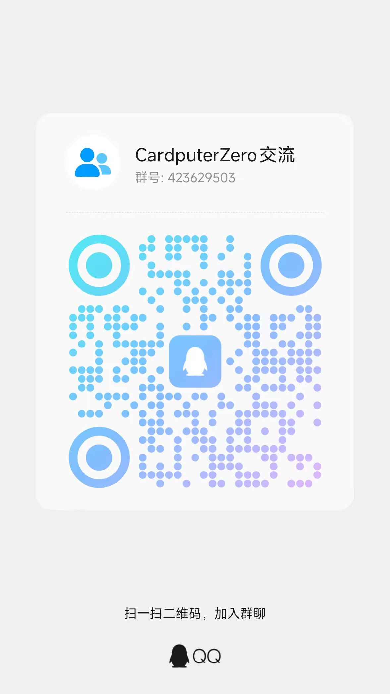

# CardputerZeroApps

适用于 CardputerZero 的应用。

- [MiMo Talk](mimo_talk/README.md) 支持流式语音识别、对话和预置音色播报。
- [amiibo_sim](amiibo_sim/README.md) 用于在 CardputerZero 上选择并模拟本地 Amiibo 备份。
- [Wallpaper](boot_assets/README.md) 通过局域网页面更换三段开机图、开机音频和锁屏图。
- [CardputerSDR](cardputersdr/README.md) 使用 USB Airspy Mini，在机身 LCD 或浏览器上显示实时频谱和瀑布图。

## QQ 群

